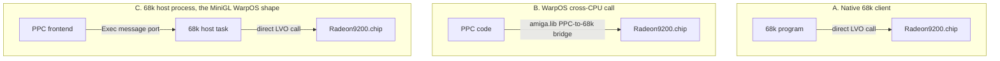
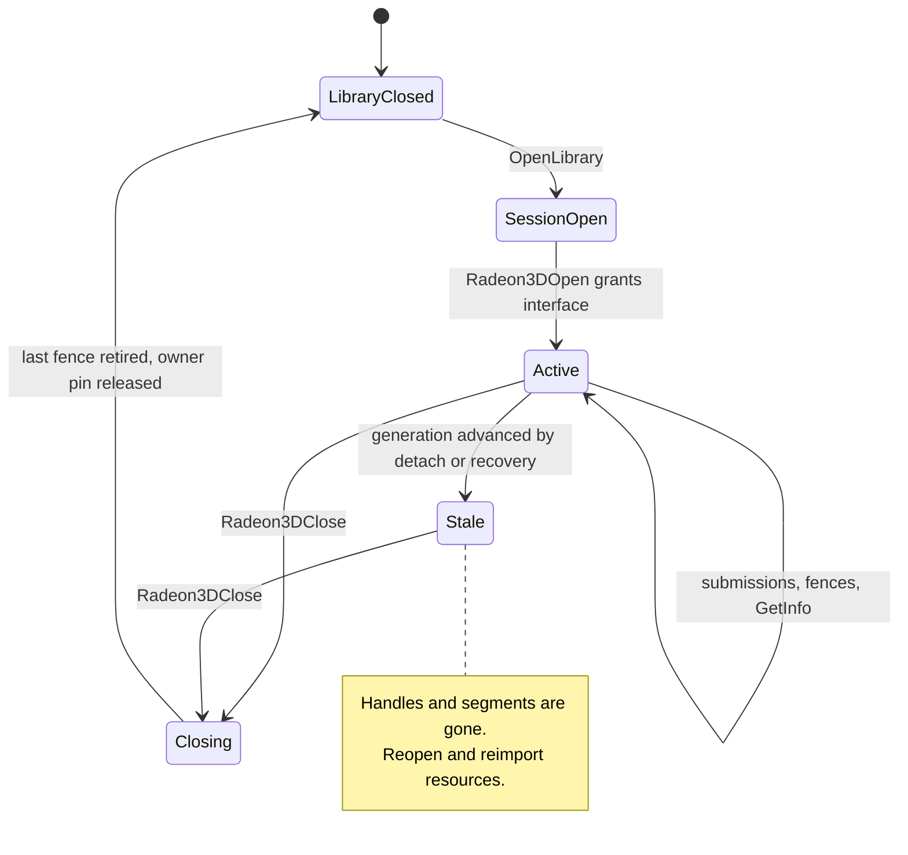
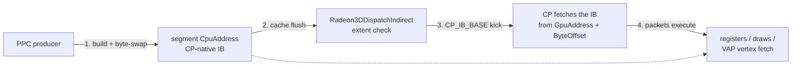
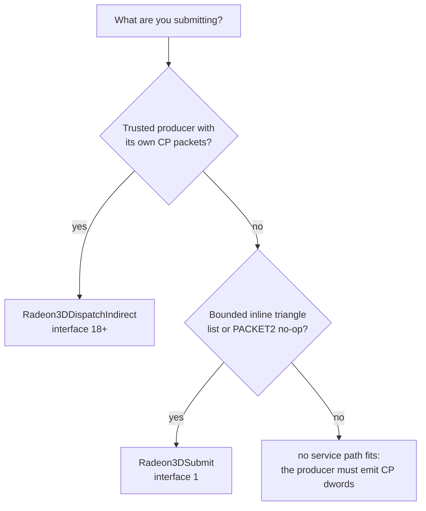
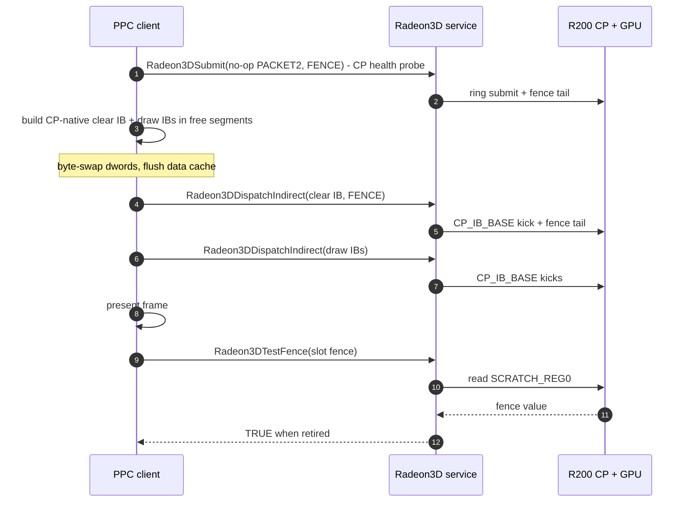

# 01 - PPC / WarpOS client guide

This is the entry point for anyone writing a PPC consumer of the Radeon3D
service: a WarpOS application, a middleware layer, an engine port, or the
MiniGL R200 backend. It explains how a PPC program reaches a driver that runs
on the 68k side, what the trust boundary is, how memory and caches must be
handled across the two CPUs, and how to use each submission path.

Everything here is the *client* view. Exact structure layouts, LVOs, record
opcodes and validation rules are in
[`02-service-abi-reference.md`](02-service-abi-reference.md); measured costs
are in [`04-performance.md`](04-performance.md).

## 1. The two-CPU model

`Radeon9200.chip` is an AmigaOS shared library whose code runs on the **host
68k CPU**. It owns PCI access, Radeon MMIO, the command processor (CP) ring,
VRAM allocation and Picasso96 display. It exposes the Radeon3D service through
ordinary library vectors.

The **PPC** (WarpOS) side never touches PCI, MMIO, the CP ring or VRAM
allocation. A PPC client:

1. obtains the library base (68k library, loaded by name `Radeon9200.chip`),
2. opens a Radeon3D *session* with `Radeon3DOpen()`,
3. imports or allocates GPU surfaces through the service,
4. optionally leases *streaming segments* (service-owned VRAM that the client
   may write directly),
5. submits work through one of the bounded entry points, and
6. retires work through *fences*.

The service validates every bounded call, translates semantic state into R200
command streams, submits them to the ring, and owns recovery.

### 1.1 How PPC code actually calls the 68k library

There are three practical topologies; the service contract is identical in all
of them, but the call cost is not:

| Topology | How it works | Relative call cost |
|---|---|---|
| 68k host process | A native 68k task opens the library and serves requests from PPC over Exec message ports. This is the shape the MiniGL WarpOS frontend uses (`MGLPPCTransport`, `MGLPPC_HOST_PORT_NAME`). | One Exec round trip per request plus driver time |
| WarpOS cross-CPU call | PPC code calls the 68k library vector through the WarpOS/`amiga.lib` PPC-to-68k bridge. | Cross-CPU context switch per call, no extra process |
| Native 68k | 68k code calls the vectors directly (probes, replay tool, 68k clients). | Cheapest; used for reference measurements |



Two consequences dominate client design:

- **Per-call overhead is large relative to small commands.** Batch many draws
  into one call. The service's own batch limit is
  `RADEON3D_MAX_BATCH_DWORDS` = 8192 dwords per call.
- **Any wait is a cross-CPU stall.** Prefer fence checks and deferred waits to
  blocking `Radeon3DWaitFence()` in the middle of frame construction; use the
  fence only when the buffer will be reused or presented.

The 68k host process topology additionally has an *asynchronous* form: send a
message, keep building the next frame, then wait for the reply. The synchronous
form (send + wait immediately) is simpler and is what the measured reference
numbers use.

### 1.2 What a call costs (reference 68060 @ 50 MHz)

Measured on the reference machine; cycles are derived at 20 ns/cycle. Full
methodology and artifact identities are in
[`04-performance.md`](04-performance.md#2-cycle-cost-table).

| Operation | Measured | Cycles |
|---|---:|---:|
| Radeon MMIO register read / write | 1.45 us / 1.33 us | ~72 / ~66 |
| Framebuffer aperture dword write | 0.61 us | ~30 |
| `HOST_DATA0` register dword write | 1.33 us | ~66 |
| Byte-swapped VRAM dword store | 0.752 us | ~38 |
| Fenced submission (full GPU idle drain + cache flush) | milliseconds | - |

(The semantic-era emitter cost rows were retired with the record path;
the historical numbers remain in
[`04-performance.md`](04-performance.md).)

Implications: a call's fixed cost is dominated by the fence drain, not by
dword count, so one frame should use a few large submissions; crossing the PCI
bridge costs ~30 cycles per dword, so avoid redundant host->VRAM copies; and a
68k-side working buffer accidentally placed in PPC RAM multiplies its access
cost by roughly 3.5-4.8x.

### 1.3 Trust boundary

| Entry point | What the service validates | Trust required |
|---|---|---|
| `Radeon3DSubmit` | Only the fixed immediate triangle-list stream (interface 1 contract) | Bounded, effectively trusted |
| `Radeon3DDispatchIndirect` | Only the *extent* of a segment range; **packet contents are not inspected** | Fully trusted producer; see the warning below |

The historical semantic record entry points (`Radeon3DExecute`,
`Radeon3DCommitDraw`, `Radeon3DCommitBatch`, `Radeon3DCommitStateBatch`)
were removed with the record path: their LVO slots are reserved and call
into a stub that returns FALSE. A client that emits its own CP packets is
the trusted producer and uses the indirect path (or, under lease, writes
the ring directly).

`Radeon3DDispatchIndirect()` is the only raw-packet path. It does not sandbox
packets: a malformed stream can corrupt the desktop, wedge the CP, or hang the
GPU (recovery may need a power cycle). Use it only when you own the packet
generator and have a hardware-validated stream.

## 2. Session lifecycle

```c
#include <proto/exec.h>
#include <proto/radeon3d.h>     /* pulls in clib/inline prototypes */

struct Radeon9200Base;          /* extern struct Library *Radeon9200Base */

struct Library *base = OpenLibrary("Radeon9200.chip",
                                   RADEON3D_LIBRARY_VERSION);
if (!base)
    return FAIL;

struct Radeon3DInfo info;
info.Size = sizeof(info);                     /* always set Size first */
struct Radeon3DDevice *dev =
    Radeon3DOpen(RADEON3D_IFACE_VERSION, &info);   /* newest you understand */
if (!dev) {
    CloseLibrary(base);
    return FAIL;
}
/* info.Version is the negotiated interface (<= requested), info.Caps the
 * capability mask, info.Generation the service generation. */
```

Rules:

- Keep the `OpenLibrary` reference open until **after** `Radeon3DClose()`
  returns. The session pins `rtg.library` for you; it does not pin the chip
  library.
- `Radeon3DOpen()` fails cleanly when the board is not attached, the CP is not
  ready, or the service is invalidated. It never half-opens.
- The returned device handle is opaque. It is validated against a live-session
  list on every call, so a stale handle cannot dereference freed memory.
- `Radeon3DClose()` waits (up to 1 s) for the session's last fence, then
  releases segments, surfaces and the owner pin. It is safe to call after a
  failed submission; it triggers bounded recovery if the fence never retires.
- `info.Generation` changes whenever the service is invalidated (board detach,
  CP abort/recovery). Compare it before reusing cached surface handles; a
  generation change means your handles and segments are gone and the session
  must be reopened.



### 2.1 Capability negotiation

`Radeon3DOpen(requestedVersion, &info)` negotiates
`min(requestedVersion, RADEON3D_IFACE_VERSION)`. Capabilities are set from that
negotiated number, plus runtime state (CP ready, pools reserved, debug build).

A robust consumer:

1. asks for the newest interface it was compiled against,
2. reads `info.Version` (the granted interface) and `info.Caps`,
3. requires every capability it cannot fall back from, and refuses to start
   with a clear message otherwise.

Do not assume a capability because the interface number is high enough:
`RADEON3D_CAP_STREAM_SEGMENTS` requires a live segment pool,
`RADEON3D_CAP_AUX_SURFACES` requires a reserved aux pool, and
`RADEON3D_CAP_INDIRECT_DISPATCH`/`INDIRECT_RENDER` require both interface 18+
and the segment pool. A debug-only bit (`RADEON3D_CAP_TEST_INVALIDATE`) must
never be required by production code.

The full capability table is in
[`02-service-abi-reference.md`](02-service-abi-reference.md#4-capability-bits).

## 3. Surfaces

The service works on *surfaces*: a CPU address, a GPU address, a pitch, a
width/height and a format. Two ways to obtain one:

### 3.1 Import a Picasso96 `BitMap` - `Radeon3DImportBitMap()`

- The bitmap must be a P96 on-board allocation in the card's visible VRAM.
- Accepted formats: `RGBFB_CLUT` (1 byte/pixel), `RGBFB_R5G6B5PC` (2),
  `RGBFB_B8G8R8A8` (4).
- The pitch must satisfy the R200 constraints the service validates; a planar
  or Fast-RAM bitmap is rejected.
- The caller keeps ownership of the bitmap and must not free it before
  `Radeon3DReleaseSurface()`.
- Typical use: rendering directly into a screen buffer or window bitmap that
  P96/Intuition also displays.

### 3.2 Allocate from the driver pool - `Radeon3DAllocSurface()`

- Interface 17+, requires `RADEON3D_CAP_AUX_SURFACES`.
- The memory is carved from private VRAM the driver reserved *before*
  Picasso96 saw the card, so it can never collide with a P96 bitmap or an
  `AllocScreenBuffer()` buffer. This is the safe way to get a depth buffer:
  the two allocators do not know about each other, and depth landing inside a
  screen buffer scribbles bands across the frame.
- Pitch is padded to 128 bytes and `Width` reports the *padded* pixel count,
  so `Width` may exceed the requested width.
- Maximum dimension 4096; pool is 4 MiB with at most 8 live surfaces.
- Release with `Radeon3DReleaseSurface()`; surfaces still held when the
  session closes are released with it.

### 3.3 Role rules

With the semantic record path gone, the service no longer inspects how a
surface is used - role rules (color/depth/texture overlap, dimensions,
pitch classes) were emitter policy and are now the trusted producer's
responsibility. The physical constraints that made the rules still hold
and a producer must respect them:

- depth must be a distinct, non-overlapping surface with the same
  dimensions as color (allocate it from the aux pool, never a screen
  buffer);
- depth is D16 in an R5G6B5PC-format surface with a pitch that is a whole
  number of 64-pixel tile pairs (128 bytes);
- textures are non-overlapping RGB565 or B8G8R8A8, at most 2048x2048,
  with a 32-byte-aligned address;
- the same surface may be sampled by both texture units; distinct
  textures must not partially overlap.

## 4. Streaming segments

A *segment* (interface 13+, `RADEON3D_CAP_STREAM_SEGMENTS`) is a service-owned
VRAM lease that the client writes directly:

```c
struct Radeon3DSegment seg;
seg.Size = sizeof(seg);
if (!Radeon3DAllocSegment(dev, 256UL * 1024UL, &seg))
    ...;
/* seg.CpuAddress : writable mapping the client may store through
 * seg.GpuAddress : GPU base used in commit records
 * seg.Id         : lease id, valid until FreeSegment or device close */
```

Up to 12 segments of at most 256 KiB each (`RADEON3D_MAX_SEGMENTS`,
`RADEON3D_MAX_SEGMENT_BYTES`). The pool is 3 MiB reserved from private VRAM.

Segment rules for PPC producers:

1. **Alignment.** `ByteOffset` in an indirect dispatch must be 16-byte
   aligned.
2. **Endianness.** Segment data is *GPU data*, not host-endian records. The
   CP and the VAP fetch little-endian dwords. A PPC (big-endian) producer
   must byte-swap every dword before storing it (equivalent to `SWAPLONG`);
   the driver's own ring writer pre-swaps in software, and the PPC ring
   writer uses `stwbrx`. For a TCL vertex dword that holds IEEE-754 floats,
   the correct operation is a full 32-bit byte swap of the float bit
   pattern.
3. **Cache.** Flush the PPC data cache over the written range before the
   dispatch call that consumes it. The GPU reads VRAM through PCI, not the
   PPC cache. On WarpOS this is `CacheClearE(address, length,
   CACRF_ClearD)` or equivalent; the exact API depends on your runtime.
   Missing this produces stale vertices that "work" until the cache line is
   evicted, which is the worst kind of intermittent bug.
4. **Lifetime.** Do not free or rewrite a segment range until the fence of the
   dispatch that references it has retired. Segments are freed
   automatically when the device closes.
5. **Ordering with CPU texture writes.** CPU-written texture data must be
   completed before the draw that samples it; the producer is responsible
   for its own cache flush.



## 5. The submission paths

The semantic record path (Execute / CommitDraw / CommitBatch /
CommitStateBatch) was removed: a cpemit producer - the PPC host emitting
CP-native dwords - is the client. Two bounded entry points and the fence
machinery remain:

| Path | Interface | Input | Best for |
|---|---|---|---|
| `Radeon3DSubmit` | 1 | Fixed immediate triangle list / PACKET2 | Bounded inline probes and the back-pressure replay tool |
| `Radeon3DDispatchIndirect` | 18+ | Pre-swapped CP packets in a segment | Trusted producer that emits its own R200 packets (the cpemit client path) |
| `Radeon3DSubmitFence` | 19+ | nothing | Closing a run of fence-less indirect dispatches (parked; see below) |



The four retired record entry points return FALSE from reserved LVO slots;
an unported consumer fails closed instead of rendering through a removed
path.

### 5.1 Trusted indirect dispatch - `Radeon3DDispatchIndirect()`

The client builds a complete **CP-native** packet stream (pre-byte-swapped for
the little-endian register bus) into a segment and dispatches a range:

```c
struct Radeon3DIndirect ib;
ib.Size = sizeof(ib);
ib.Version = RADEON3D_INDIRECT_VERSION;
ib.SegmentId = seg.Id;
ib.ByteOffset = 0;                 /* 16-byte aligned */
ib.DwordCount = dwords;            /* nonzero, even, <= 8192 */
ib.Flags = 0;                      /* or RADEON3D_INDIRECT_NO_FENCE (parked) */
ULONG fence;
BOOL ok = Radeon3DDispatchIndirect(dev, &ib, &fence);
```

The service writes `PACKET0(CP_IB_BASE, 1)` with the segment GPU address and
dword count, then the standard retiring fence. It validates only the extent:
segment identity, 16-byte offset alignment, even nonzero count within the
lease. Contents are your responsibility.

Odd-length streams must be padded by the producer with one CP-native PACKET2
and included in the count (the service rejects odd counts rather than padding
in place, following Linux `radeon_cp_dispatch_indirect()`).

For rendering, require **both** `RADEON3D_CAP_INDIRECT_DISPATCH` and
`RADEON3D_CAP_INDIRECT_RENDER`. The latter adds the prepare/revalidation,
submitted-state and recovery hooks that make rendering safe; bit 26 alone is
the older fetch/fence smoke path.

> **Parked:** interface-19 fence coalescing
> (`RADEON3D_INDIRECT_NO_FENCE` + `Radeon3DSubmitFence`) is present in the
> ABI but default-off and **not deployable**: three hardware attempts at
> back-to-back indirect fetches produced a hard wedge, corrupted rendering and
> a silent submission stall. See
> [`07-history.md`](07-history.md#31-interface-19-fence-coalescing-parked).

### 5.2 Bounded inline submits - `Radeon3DSubmit()`

Interface-1 clients may submit either an all-PACKET2 no-op batch or the fixed
22-register immediate triangle-list stream (RGB565 target, screen-space
vertices, at most 255 vertices per call; exact layout in
[`02-service-abi-reference.md`](02-service-abi-reference.md#9-bounded-inline-immediate-triangle-list)).
It cannot express texture, TCL or depth - those belong in a producer's
indirect buffers. `r3dreplay` drives it as the standing back-pressure
regression workload. Require `RADEON3D_CAP_IMMD_TRI_LIST`.

## 6. Fences

A fence is a nonzero `ULONG` token returned by a successful submission when
`RADEON3D_SUBMIT_FENCE` is set (or, for `Radeon3DSubmit`, always internally).

Semantics:

- Fences are **monotonic per session**. `Radeon3DTestFence()` and
  `Radeon3DWaitFence()` accept any fence the session has submitted in the live
  range `(0, LastFence]` when `RADEON3D_CAP_MULTI_FENCE` is present.
- A fence retiring means every earlier submission in ring order has completed,
  including fence-less ones.
- `Radeon3DTestFence()` is non-blocking and also invalidates the host read
  buffer, so it is the cheap way to poll.
- `Radeon3DWaitFence(dev, fence, timeoutMs)`: nonzero timeout is a wall-clock
  budget clamped to 60 s; zero performs one non-blocking test. Wait in
  milliseconds, not spins.
- A failed submission returns FALSE and writes `0x80000000 | stage` (or
  `0x80000000 | (group << 16) | stage`) to `fenceOut`. **Always check the
  BOOL result before using a fence token.**
- The service performs bounded recovery after a failed submit; existing
  sessions are stale afterwards and must be reopened.

Recommended client pattern (double-buffered geometry):

```text
for each frame:
    if (segment slot in use && !TestFence(dev, slot.fence))
        skip/steal slot (never overwrite in-flight indirect buffers)
    build the CP-native IB into the free slot, flush cache
    dispatch with FENCE, store the returned token in the slot
```

Do not hold a wait in the middle of the frame unless the buffer is genuinely
needed; use the test-first pattern above to keep the GPU fed.

## 7. Memory, endianness and cache - PPC checklist

| Concern | Rule |
|---|---|
| Submit/indirect descriptors | Host-endian (big-endian on both CPUs). No conversion. |
| CP-native indirect buffers | Little-endian dwords; producer byte-swaps once. |
| Segment vertex data | Little-endian GPU data; PPC producer byte-swaps floats/dwords. |
| PPC cache | Flush written segment ranges before dispatch. |
| 68k working buffers | The driver prefers local Fast RAM for its own working buffers (`MEMF_LOCAL` + `TypeOfMem` FAST check). Keep client-side staging out of PPC RAM if a 68k host will read it. |
| Alignment | Indirect: 16-byte offsets. Textures: 32-byte aligned. |
| Size | One call <= 8192 dwords total input. `MaxBatchDwords` is authoritative. |
| Lifetime | Bitmaps until `ReleaseSurface`; segments until fence retirement; session until `Radeon3DClose`. |

PPC-RAM placement is a measured, large penalty: moving three private 68k
working buffers out of PPC RAM raised a 600-frame gears median from 44.3 to
54.6 FPS (+23.3%). See
[`04-performance.md`](04-performance.md#7-ppc-memory-placement).

## 8. Worked integration sequence

A frame in the cpemit shape, from the client's point of view:



```text
MGLInit / driver start:
    base = OpenLibrary("Radeon9200.chip", 3)
    info.Size = sizeof(info)
    dev  = Radeon3DOpen(RADEON3D_IFACE_VERSION, &info)
    require CAP_CP_READY, CAP_BITMAP_IMPORT
    for indirect:  require CAP_INDIRECT_DISPATCH + CAP_INDIRECT_RENDER
                   + CAP_STREAM_SEGMENTS

context creation:
    color = ImportBitMap(window/screen buffer)   or AllocSurface(...)
    depth = AllocSurface(w, h, R5G6B5PC)         (aux pool)
    AllocSegment(256 KiB) x N                    (IB + vertex storage)

texture upload:
    import a P96 texture bitmap (or aux surface)
    write texels (CPU), flush cache
    the producer's next IB programs the texture unit state itself

frame:
    build CP-native clear IB + draw IBs in free segment slots
    (byte-swap every dword, flush the data cache)
    DispatchIndirect(clear IB, FENCE)
    DispatchIndirect(draw IBs)
    present via the normal window/screen-buffer mechanism
    optionally TestFence before reusing a slot

shutdown:
    Radeon3DReleaseSurface(each)
    Radeon3DFreeSegment(each)
    Radeon3DClose(dev)
    CloseLibrary(base)
```

## 9. Common client mistakes

- **Assuming `OpenLibrary("Radeon9200.chip")` finds a path.** It is opened by
  resident name. `Picasso96` loads it from `LIBS:Picasso96/`; clients open the
  name. A debug chip installed under its own file name breaks every MiniGL
  client because `minigl.library` opens the exact internal name.
- **Holding a wait fence per draw.** Each full idle drain is milliseconds of
  GPU time; batch first, wait once per frame or per buffer rotation.
- **Not flushing the PPC cache over segment writes.** Intermittent stale
  geometry; the classic symptom is "works until memory pressure".
- **Writing host-endian dwords into a segment.** The CP and the vertex
  fetcher are little-endian; unswapped dwords produce garbage packets,
  triangles or CP stalls.
- **Reusing a segment range before its fence retires.** Corruption that looks
  like a driver bug.
- **Calling a removed record entry point.** `Radeon3DExecute` and the three
  commit calls sit on reserved LVO slots and return FALSE; port the producer
  to indirect dispatch instead of retrying.
- **Requiring interface 19 features.** The shipped/deployed driver may be
  older, and the fence-coalescing path is parked. Negotiate and degrade.
- **Mixing depth into a P96 screen buffer.** Always allocate depth through
  `Radeon3DAllocSurface()`.
- **Treating `Radeon3DDispatchIndirect` as sandboxed.** It is not; it is a
  trusted raw-packet path.

## 10. Interface-20 engine lease (PPC-direct 3D)

The recommended production pattern on a driver that advertises
`RADEON3D_CAP_PPC_RING` (bit 30, interface 20), validated on the physical
machine 2026-09-23 (see `docs/09-ppc-direct-ring-design.md`):

```text
per frame:
    acquire lease  (one cross-CPU library call)
    while lease live:
        reserve ring space by polling RB_RPTR (MMIO, local)
        write CP-native dwords with stwbrx bursts (VRAM aperture, local)
        read back the final dword before publishing (posted-write order)
        kick CP_RB_WPTR with a committed (write + readback) MMIO write
        poll SCRATCH_REG0 locally for fences
    release lease with the last fence (one cross-call)
```

During the lease the 68k refuses every other submission (failure stage 122)
and Picasso96 2D renders in software, so the desktop stays alive and
correct. On release the service drains via the lease's last fence, re-arms
the 68k ring state and restores 2D. The lease expires after a
service-defined bound if the holder dies; the 2D path then reclaims it with
full recovery (this ran in the wild during bring-up and behaved as
designed).

**Automatic fallback**: without `RADEON3D_CAP_PPC_RING`, or whenever
`Radeon3DAcquireLease` returns FALSE (busy lease, refused grant, or a
`make PPCRING=0` fallback-only driver), the consumer uses the existing
bounded paths (`Radeon3DSubmit` / indirect dispatch) unchanged -
the old behavior is the built-in fallback, no configuration needed. The
lease is optional and additive; never require it in production code without
a working fallback path.

PPC-side notes for the direct-ring writer:

- Ring dwords are little-endian on the wire; `stwbrx` publishes them with
  the swap included.
- The PPC's **loads** of the aliased VRAM window are cache-served (Phase-0
  measured 29 ns cache hits): invalidate lines (`dcbf`) before polling any
  68k-written location. Stores commit with `eieio`/`sync`.
- MMIO loads (`RB_RPTR`, `SCRATCH_REG0`) are uncached and real; the
  committed WPTR kick shape (store + readback of the same register) is the
  driver's publication discipline.
