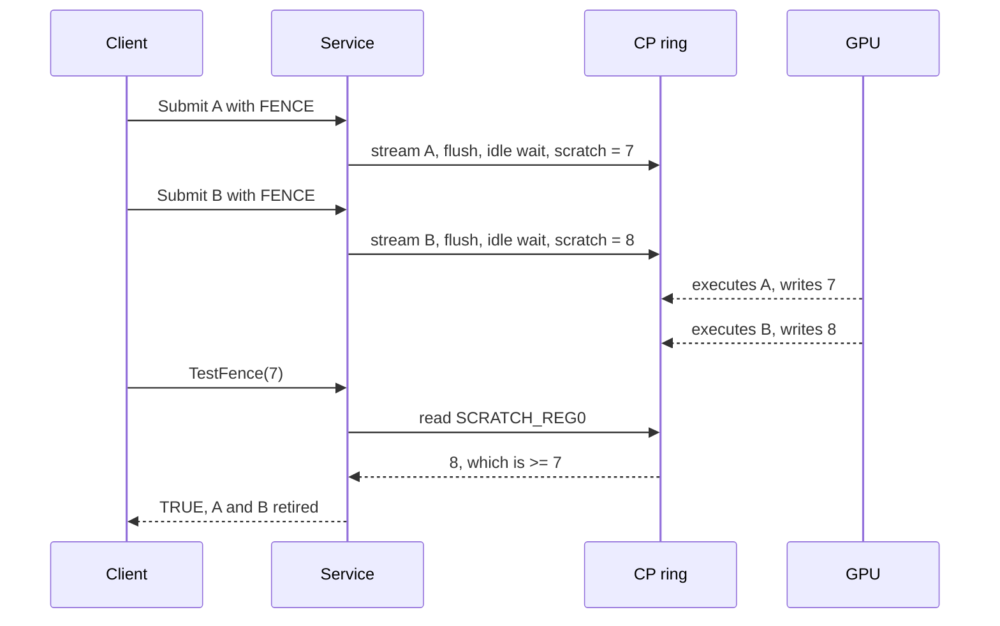

# 02 - Radeon3D service ABI reference

Canonical source: [`include/radeon3d.h`](../include/radeon3d.h) (public
structures and constants), [`include/radeon9200_chip.sfd`](../include/radeon9200_chip.sfd)
(function list), [`include/clib/radeon3d_protos.h`](../include/clib/radeon3d_protos.h),
[`include/inline/radeon3d_protos.h`](../include/inline/radeon3d_protos.h)
(68k GCC inline calls), and [`src/radeon3d_service.c`](../src/radeon3d_service.c)
(validation). When this document and the headers disagree, the headers win -
and this document is then wrong and must be fixed.

A consumer-side vendored copy exists at
the MiniGL V19 consumer tree's
`/home/mirek/MiniGL_WOS_V19_mglQ3/backend_r200/third_party/radeon3d/include/`.
It is synced in the same commit as every ABI change (latest: the
remove-semantic change of 2026-10-19).

## 1. Library identity and opening

| Property | Value |
|---|---|
| Resident name | `Radeon9200.chip` |
| On-disk path (Picasso96) | `LIBS:Picasso96/Radeon9200.chip` |
| `lib_Version` / `lib_Revision` | 3 / 1 |
| Version string | `Radeon9200.chip 3.1 (19.10.2026)` |
| Node type / priority | `NT_LIBRARY` / -50 |
| Minimum CPU | `AFF_68020` (the library refuses to initialize on 68000) |
| Radeon3D library version | `RADEON3D_LIBRARY_VERSION` = 3 |
| Radeon3D interface version | `RADEON3D_IFACE_VERSION` = 20 |

Open by **resident name**, not by path. `OpenLibrary("Radeon9200.chip", 3)`
is what clients and `minigl.library` use; only Picasso96 loads the file from
`LIBS:Picasso96/` during monitor initialization. The DEBUG build keeps the
resident name `Radeon9200.chip` on purpose (see
[`05-build-deploy-run.md`](05-build-deploy-run.md#31-debug-builds)).

`Radeon9200Base` is the library base used by the inline macros; the caller
defines `struct Library *Radeon9200Base;` (or `#define RADEON3D_BASE_NAME`
before including `<inline/radeon3d.h>`).

## 2. LVO table

Negative offsets from the base in `A6`. `Size` fields must be set by the
caller before every structure-taking call.

| LVO | Function | Notes |
|---:|---|---|
| -30 | `InitChip` | Picasso96 entry; not a client API |
| -36 | `InitRadeonFeatures` | Picasso96 entry; not a client API |
| -42 | `Radeon3DOpen(ULONG requestedVersion, struct Radeon3DInfo *info)` | returns device handle or NULL |
| -48 | `Radeon3DClose(struct Radeon3DDevice *device)` | waits last fence up to 1 s |
| -54 | `Radeon3DGetInfo(struct Radeon3DDevice *device, struct Radeon3DInfo *info)` | refresh caps/counters/telemetry |
| -60 | `Radeon3DDetachOwner` | private, Prometheus/Picasso96 shutdown only |
| -66 | `Radeon3DSubmit(struct Radeon3DDevice *, const ULONG *commands, ULONG commandCount, ULONG flags, ULONG *fenceOut)` | interface-1 bounded packet path |
| -72 | `Radeon3DTestFence(struct Radeon3DDevice *, ULONG fence)` | non-blocking |
| -78 | `Radeon3DWaitFence(struct Radeon3DDevice *, ULONG fence, ULONG timeoutMs)` | 0 = one test; nonzero clamped to 60 s |
| -84 | `Radeon3DImportBitMap(struct Radeon3DDevice *, struct BitMap *, struct Radeon3DSurface *)` | P96 on-board bitmap |
| -90 | `Radeon3DReleaseSurface(struct Radeon3DDevice *, struct Radeon3DSurface *)` | void |
| -96 | *reserved* | was `Radeon3DExecute`; removed with the semantic record path, returns FALSE |
| -102 | `Radeon3DInvalidateForTest(struct Radeon3DDevice *)` | DEBUG builds only; release returns FALSE |
| -108 | `Radeon3DAllocSegment(struct Radeon3DDevice *, ULONG bytes, struct Radeon3DSegment *)` | interface 13+ |
| -114 | `Radeon3DFreeSegment(struct Radeon3DDevice *, ULONG segmentId)` | interface 13+ |
| -120 | *reserved* | was `Radeon3DCommitDraw` |
| -126 | *reserved* | was `Radeon3DCommitBatch` |
| -132 | *reserved* | was `Radeon3DCommitStateBatch` |
| -138 | `Radeon3DAllocSurface(struct Radeon3DDevice *, ULONG width, ULONG height, ULONG format, struct Radeon3DSurface *)` | interface 17+ |
| -144 | `Radeon3DDispatchIndirect(struct Radeon3DDevice *, const struct Radeon3DIndirect *, ULONG *fenceOut)` | interface 18+ |
| -150 | `Radeon3DSubmitFence(struct Radeon3DDevice *, ULONG *fenceOut)` | interface 19+, parked |
| -156 | `Radeon3DAcquireLease(struct Radeon3DDevice *, struct Radeon3DLease *lease)` | interface 20+, PPC engine lease |
| -162 | `Radeon3DReleaseLease(struct Radeon3DDevice *, ULONG lastFence)` | interface 20+, drains via the lease's last fence |

The reserved slots are load-bearing: every vector at -102 and above keeps
its historical offset so existing inline stubs (the PPC cpemit client
above all) keep working. The reserved vectors return FALSE.

`RADEON3D_SUBMIT_FENCE` (`1UL << 0`) is the only public submission flag.
`RADEON3D_INDIRECT_NO_FENCE` (`1UL << 1`) is the indirect-dispatch flag
(parked).

## 3. Version negotiation

`Radeon3DOpen(requestedVersion, info)` grants
`min(requestedVersion, RADEON3D_IFACE_VERSION)` and writes it to
`info->Version`. Capabilities are cumulative by granted interface number, with
runtime gates:

| Granted interface | Capabilities added |
|---:|---|
| 1 | CP_READY, SINGLE_BOARD, OWNER_PINNED, PACKET2_SUBMIT, FENCES, BITMAP_IMPORT, IMMD_TRI_LIST |
| 5 | TEST_INVALIDATE (DEBUG builds only) |
| 13 | STREAM_SEGMENTS (if the segment pool exists) |
| 17 | AUX_SURFACES (if the aux pool exists) |
| 18 | INDIRECT_DISPATCH, INDIRECT_RENDER (if the segment pool exists), MULTI_FENCE |
| 19 | FENCE_COALESCE |
| 20 | PPC_RING (engine lease; requires the flag, a live CP, the segment pool and a working EClock) |

Interfaces 2-16 once added the semantic record capabilities (bits 7-20,
22-24). Those bits are **withdrawn** as of the remove-semantic change: the
capability table skips straight from the interface-1 set to
TEST_INVALIDATE/STREAM_SEGMENTS, and a driver built after the change never
sets the retired bits regardless of the negotiated version. Positions 7-20
and 22-24 are not reused below interface 21.

An interface-17 consumer keeps working against a 20 driver and simply never
sees bits 26-30. Conversely, a 20 consumer on an older driver receives a lower
`info.Version` and must not use newer vectors: the LVO physically exists only
if the driver exports it, so gate by capability, not by "the library version
looks new".

## 4. Capability bits

| Bit | Name | Meaning |
|---:|---|---|
| 0 | `CP_READY` | Command processor initialized and ring live |
| 1 | `SINGLE_BOARD` | One board instance per chip library load |
| 2 | `OWNER_PINNED` | Sessions pin `rtg.library` so `BoardInfo` cannot expire |
| 3 | `PACKET2_SUBMIT` | `Radeon3DSubmit` accepts PACKET2 no-op batches |
| 4 | `FENCES` | Fence tokens are returned and waitable |
| 5 | `BITMAP_IMPORT` | `Radeon3DImportBitMap` available |
| 6 | `IMMD_TRI_LIST` | Fixed immediate triangle-list stream accepted |
| 11 | `TEST_INVALIDATE` | Diagnostic recovery hook; DEBUG builds only |
| 21 | `STREAM_SEGMENTS` | Segment pool and the indirect path's storage |
| 25 | `AUX_SURFACES` | `Radeon3DAllocSurface` and its reserved pool |
| 26 | `INDIRECT_DISPATCH` | `Radeon3DDispatchIndirect` (fetch/fence eligible) |
| 27 | `INDIRECT_RENDER` | Indirect path has render transitions/recovery |
| 28 | `MULTI_FENCE` | Any session fence in `(0, LastFence]` is testable/waitable |
| 29 | `FENCE_COALESCE` | Interface-19 no-fence dispatch + `SubmitFence` (parked) |
| 30 | `PPC_RING` | Interface-20 engine lease: during the lease the PPC is the only ring writer; the 68k refuses submissions and 2D falls back to software |

Retired positions (never set, not reused below interface 21): 7-20 held the
semantic record capabilities (`PHASE2_EXECUTE`, `DEPTH_FUNCS`,
`TEXTURE_STATE`, `FOG_MULTITEX`, `COLOR_TARGET_FORMATS`,
`NATIVE_TRI_PRIMITIVES`, `NATIVE_QUAD_LISTS`, `HW_TRANSFORM_CLIP`,
`HW_TEXGEN`, `HW_NORMALS`, `HW_LIGHTING`, `HW_SPHERE_MAP`,
`COMPACT_TCL_VERTEX`), 22-24 held `COMMIT_STATE_REUSE`,
`COMMIT_STATE_BATCH` and `ORDERED_COMMITS`.

## 5. Info block

```c
struct Radeon3DInfo {
    ULONG Size;               /* in: caller's buffer size, out: tier filled */
    ULONG Version;            /* negotiated interface version */
    ULONG Generation;         /* service generation */
    ULONG DeviceId;           /* PCI device id, e.g. 0x5964 */
    ULONG Caps;               /* capability mask */
    ULONG InstalledVram;      /* bytes of VRAM on the board */
    ULONG Picasso96Vram;      /* bytes Picasso96 may allocate */
    ULONG MaxBatchDwords;     /* 8192 */
    /* V2 tail - cumulative submission attribution, microseconds, all builds.
     * Historical "Exec" field names, frozen info ABI. */
    ULONG ExecCalls;
    ULONG ExecRecordDwords;
    ULONG ExecGeneratedDwords;
    ULONG ExecCopyMicros;
    ULONG ExecBuildMicros;
    ULONG ExecSubmitMicros;
    /* V3 tail */
    ULONG CommitFailStage;    /* stage of the most recent failed submission, 0 = none */
    /* V4 tail - release-safe per-submission timing ring */
    APTR  SampleRing;         /* driver-owned RADEON3D_SAMPLE_RING_SIZE entries */
    ULONG SampleRingEntries;
    ULONG SampleSeq;
    ULONG EClockHz;
};
```

Size tiers: `RADEON3D_INFO_V1_SIZE` = 32,
`RADEON3D_INFO_V2_SIZE` = 56, `RADEON3D_INFO_V3_SIZE` = 60,
`RADEON3D_INFO_V4_SIZE` = 76. The driver fills only complete tiers that fit
the caller's buffer and reports the largest tier actually filled in `Size`;
a caller sitting between tiers keeps the lower one. `ExecCopy/Build/SubmitMicros`
are 64-bit-converted from EClock ticks once per phase boundary; the sample ring
keeps raw ticks and lets the reader convert with `EClockHz`.

### 5.1 Sample ring

`RADEON3D_SAMPLE_RING_SIZE` = 1024 entries. One sample is written at the end
of every submission call that reached the service, success or failure:

```c
struct Radeon3DSample {
    ULONG Seq;             /* global sequence number; written last */
    ULONG WallTicks;       /* EClock low word at completion */
    ULONG Type;            /* RADEON3D_SAMPLE_* */
    ULONG Result;          /* nonzero on success */
    ULONG RecordDwords;    /* host dwords the call received */
    ULONG GeneratedDwords; /* CP dwords it produced */
    ULONG CopyTicks;       /* staging copy (Submit's trusted snapshot; else 0) */
    ULONG BuildTicks;      /* validation + command build */
    ULONG SubmitTicks;     /* CP ring submit including fence work */
};
```

Types: `SUBMIT` 5, `DISPATCH` 6. Types 1-4 (`EXECUTE`, `COMMIT_DRAW`,
`COMMIT_BATCH`, `STATE_BATCH`) belong to the retired semantic record path
and appear only in sample rings captured by older drivers. Entry `Seq` is
cleared before the payload is rewritten and published last, so a lock-free
reader copies an entry only while `Seq` matches and re-verifies after the
copy. `radeon3dinfo` dumps the ring as `R3DSAMPLE` lines;
`tools/perfplot.py` groups them into frames.

## 6. Surfaces

```c
struct Radeon3DSurface {
    ULONG Size;         /* set by caller */
    ULONG Version;      /* out: RADEON3D_SURFACE_VERSION = 1 */
    ULONG Generation;   /* out: generation at import/alloc time */
    APTR  CpuAddress;   /* out: CPU mapping */
    ULONG GpuAddress;   /* out: GPU address */
    ULONG Pitch;        /* out: bytes per row (128-byte padded for aux) */
    ULONG Width;        /* out: width (padded for aux) */
    ULONG Height;       /* out */
    ULONG Format;       /* out: RADEON3D_FORMAT_* */
    APTR  Handle;       /* out: opaque handle (service-internal identity) */
};
```

Size: 40 bytes (`RADEON3D_SURFACE_V1_SIZE`).

Formats:

| Constant | Value | Bytes/pixel | Notes |
|---|---:|---:|---|
| `RADEON3D_FORMAT_R5G6B5PC` | 1 | 2 | little-endian 565; the primary color/depth format |
| `RADEON3D_FORMAT_B8G8R8A8` | 2 | 4 | B, G, R, X byte order; fourth byte unused by P96 |
| `RADEON3D_FORMAT_CLUT8` | 3 | 1 | direct RGB332 with hardware dithering as a color target |

Depth is always D16 stored in an R5G6B5PC-format surface. Imported bitmaps must
be P96 on-board allocations; planar or Fast-RAM bitmaps are rejected. Aux
surfaces are allocated from a 4 MiB private pool (`RADEON3D_AUX_POOL_BYTES`),
at most 8 live (`RADEON3D_MAX_AUX_SURFACES`), maximum dimension 4096
(`RADEON3D_AUX_MAX_DIMENSION`), pitch rounded up to 128 bytes.

## 7. Streaming segments

```c
struct Radeon3DSegment {
    ULONG Size;        /* in */
    ULONG Version;     /* out: 1 */
    ULONG Id;          /* out: 0..11 lease id */
    APTR  CpuAddress;  /* out: writable mapping */
    ULONG GpuAddress;  /* out: GPU base */
    ULONG Bytes;       /* out: granted bytes (as requested) */
};
```

Size: 24 bytes. `RADEON3D_MAX_SEGMENTS` = 12,
`RADEON3D_MAX_SEGMENT_BYTES` = 256 KiB, requested bytes must be nonzero,
4-byte aligned and within the maximum. Pool total 3 MiB. The client never
supplies a raw GPU address anywhere; indirect dispatches reference segment
ids.

## 8. Indirect dispatch

```c
struct Radeon3DIndirect {
    ULONG Size;         /* 24 */
    ULONG Version;      /* 1 */
    ULONG SegmentId;
    ULONG ByteOffset;   /* 16-byte aligned */
    ULONG DwordCount;   /* nonzero, even, <= 8192 */
    ULONG Flags;        /* 0 or RADEON3D_INDIRECT_NO_FENCE (parked) */
};
```

Validated: session interface >= 18 (and >= 19 for `NO_FENCE`), live segment
lease, `ByteOffset + DwordCount*4` within the lease, GPU-address overflow
guard, descriptor snapshotted before `RadeonPrepare3D()` so a caller mutation
during prepare cannot change the submitted address or count.

Failure stages (also written into `CommitFailStage`; the name is part of
the frozen V3 info ABI):

| Stage | Meaning |
|---:|---|
| 100/101 | descriptor/flag/count/alignment rejection before locking |
| 102 | session unusable at lock |
| 103 | interface < 18/19, no pool, or bad segment id |
| 104/105 | range or GPU-address overflow |
| 106 | submission failed |
| 107 | `RadeonPrepare3D` failed |
| 108 | stale state after prepare (generation/board/lease changed) |
| 110-116 | `Radeon3DSubmitFence` equivalents |

(The historical commit-path stages 1-8, 40-44 and 80-86 were removed with
the semantic record path; a `CommitFailStage` holding one of those values
comes from an older driver.)

## 9. Bounded inline immediate triangle list

`Radeon3DSubmit()` accepts either all-`PACKET2` batches or exactly this stream:
22 single-register `PACKET0` writes followed by one `3D_DRAW_IMMD_2` packet.
All dwords host-endian; the service performs PCI byte swapping. Target: a live
imported 16-byte-aligned R5G6B5PC bitmap whose dimensions/pitch match the
register values.

```text
SE_VAP_CNTL_STATUS   0
SE_VAP_CNTL          FORCE_W_TO_ONE | (9 << VF_MAX_VTX_NUM_SHIFT)
SE_VTX_STATE_CNTL    0
SE_VTE_CNTL          0
SE_VTX_FMT_0         packed RGBA color 0
SE_VTX_FMT_1         0
SE_CNTL              solid front/back, diffuse Gouraud, OGL pixel center,
                     1/4 rounding (0x9800021e)
PP_CNTL              texture blend stage 0 enabled
PP_TXCBLEND_0        diffuse color
PP_TXCBLEND2_0       clamp 0..1, output R0
PP_TXABLEND_0        diffuse alpha
PP_TXABLEND2_0       clamp 0..1, output R0
PP_CNTL_X            0
RE_AUX_SCISSOR_CNTL  0
RE_CNTL              0
RE_TOP_LEFT          0
RE_WIDTH_HEIGHT      ((height-1) << 16) | (width-1)
RB3D_PLANEMASK       0xffffffff
RB3D_BLENDCNTL       source ONE, destination ZERO
RB3D_CNTL            RGB565
RB3D_COLOROFFSET     imported surface GPU address
RB3D_COLORPITCH      imported surface pitch / 2
```

Final packet:

```text
PACKET3(3D_DRAW_IMMD_2, vertexCount * 3)
(vertexCount << 16) | PRIM_WALK_RING | TRI_LIST
per vertex: IEEE-754 X, IEEE-754 Y, packed RGBA
```

`vertexCount` is a positive multiple of three from 3 through
`RADEON3D_IMMD_MAX_VERTICES` (255). X/Y are non-negative finite values within
the target. Anything else is rejected before the ring write pointer changes.

## 10. Fence and error semantics

- A successful submission with `RADEON3D_SUBMIT_FENCE` writes a nonzero fence
  token to `fenceOut`. `Radeon3DSubmit` always creates an internal fence; it
  reports it only when the flag is set.
- Every fenced submission appends a 6-dword cache flush plus a full GPU idle
  wait. On the reference machine that drain costs milliseconds, which is why
  the service is built around large batches and one wait per buffer rotation
  rather than one wait per draw (measured costs in
  [`04-performance.md`](04-performance.md#2-cycle-cost-table)).
- Fence range validation: with `MULTI_FENCE`, any fence in the live submitted
  range `(0, LastFence]` is testable/waitable; without it, only `LastFence`.
  Monotonic wrap is handled (`CpFenceReached`).
- `Radeon3DWaitFence(dev, fence, 0)` is one non-blocking test.
- Failed calls return FALSE. `Radeon3DDispatchIndirect` and
  `Radeon3DSubmitFence` write `0x80000000 | stage` to `fenceOut`; the same
  value appears in `info.CommitFailStage` for the most recent failure.
  `Radeon3DSubmit` leaves `fenceOut` at zero on failure (validation
  failures have no stage).
- `Radeon3DTestFence` also invalidates the host read buffer so a following CPU
  read sees GPU writes.

Fences are ring-ordered: a retiring later fence proves every earlier
submission completed, so one wait can retire a whole frame's submissions.



## 11. Limits summary

| Limit | Value |
|---|---:|
| Max batch dwords per call | 8192 |
| Immediate vertices | 255 |
| Segments | 12 x 256 KiB |
| Aux surfaces | 8, 4 MiB pool, 4096 max dimension |
| Textures | 2048x2048, RGB565 or B8G8R8A8 |
| Fence wait clamp | 60 s |
| Sample ring | 1024 entries |
| Texture units | 2 |

(The semantic-era limits - inline quad vertices, streaming-commit vertex
bounds, 192 state-batch draws, 8 light blocks - were removed with the
record path.)

## 12. ABI layout rules

- Public structures use only fixed-width AmigaOS types and the normal m68k
  two-byte alignment.
- Every structure has a compile-time size assertion in `radeon3d.h`; keep
  them when editing.
- `Size` is the first field of every structure and is set by the caller before
  the call. The driver reads only fields that fit the declared size tier and
  rejects undersized structures.
- The `struct Radeon3DInfo` tail layout is frozen at the V4 sizes; the
  historical `Exec*` field names stay even though they now attribute
  generic submissions.
- The reserved LVO slots at -96/-120/-126/-132 must never be reassigned;
  every later vector keeps its offset (see section 2).
- `include/radeon3d_emit.h` holds only the shared float validators used by
  stream validation; the record emitter it once declared was removed with
  the semantic record path.

## 13. Interface-20 PPC engine lease

`Radeon3DAcquireLease(device, &lease)` grants an exclusive ring lease to the
calling session (physical Phase-2 run 2026-09-23):

- While the lease is live, **the PPC is the only ring writer**. Every 68k
  service submission (`Submit`, indirect, `SubmitFence`)
  is refused with `CommitFailStage` 122, and Picasso96 2D is parked in
  `RADEON_ACCEL_FALLBACK` (software rendering) until the lease ends.
- The lease dies with an explicit `Radeon3DReleaseLease(device, lastFence)`,
  with the session, or after the expiry bound (5 s from grant; a stale lease
  is reclaimed by the 2D path with full recovery, which also invalidates the
  session - the dead-client protection ran in the wild during the first
  hardware bring-up and behaved as designed).
- The lease descriptors are 68k-mapped addresses the PPC aliases 1:1
  (Phase-0 verified): `RingCpuAddress` (ring base for the `stwbrx` writer),
  `RingGpuAddress`, `RingDwords`/`RingMask`, `Bar2Base` (MMIO:
  `CP_RB_RPTR` 0x0710, `CP_RB_WPTR` 0x0714, `SCRATCH_REG0` 0x15e0),
  `Bar0Base`, and `NextFence` (the first scratch sequence the lease may
  use; the host's own proof batch has already consumed the earlier ones).
- The PPC's fence tails use the standard six-dword shape (cache flush +
  full idle wait + scratch sequence), so `Radeon3DReleaseLease(lastFence)`
  retires every lease submission in ring order, re-arms the 68k write
  pointer from `RB_RPTR` and restores 2D acceleration.

Failure stages (also in `CommitFailStage`): 120 not allowed (fallback build
or missing prerequisites), 121 interface < 20, 122 lease busy (already
active), 123 lease not held / never arrived, 124 holder mismatch,
125 grant failure (prepare or ring info).

**Fallback flag**: `make PPCRING=0` builds `Radeon9200-noppcring.chip` - a
fallback-only driver that never advertises `RADEON3D_CAP_PPC_RING` and
refuses every lease. Default is `PPCRING=1` (PPC-direct 3D preferred). In
every case the bounded entry points remain fully functional, so a consumer
without the capability - or with a refused lease - automatically uses the
existing paths unchanged. The lease is purely additive; nothing existing
changes behavior.

Phase-0/2 hardware results (2026-09-23): the PPC writer submitted 32 fenced
PACKET2 batches directly to the ring and retired them locally in ~125-200 us
total; the 68k cross-checked SCRATCH_REG0 = the lease's last fence through
its own aperture; the ring state survived the release (drained, re-armed).
