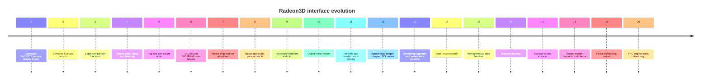

# 07 - History, decisions and open work

This is the condensed chronological record. It exists so a new developer can
understand **why** the driver looks the way it does, and which experiments
already failed. It replaces the older per-topic progress files that used to sit
in the repository root.

All artifact CRCs are historical identities of specific binaries, not current
values. A rebuild changes them.

## 1. Interface evolution

| Interface | Added | Key capabilities |
|---:|---|---|
| 1 | first service | Discovery, PACKET2/immediate triangle submission, fences, bitmap import |
| 2 | semantic records | `Radeon3DExecute`, clear + triangle records |
| 3 | depth functions | Eight depth comparisons |
| 4 | texture state | 15-dword header, samplers, mip levels, alpha test, blending |
| 5 | fog/multitexture | 21-dword header, unit 1, fog, diagnostic invalidation |
| 6 | color formats | CLUT8 (RGB332) and B8G8R8A8 targets |
| 7 | native primitives | Triangle strip/fan |
| 8 | quad lists | Native quads, perspective clip coordinates |
| 9 | hardware TCL | 44-dword header, points/lines, hardware transform+clip |
| 10 | texgen | Object-linear texgen block |
| 11 | normals/lighting | Normal matrices, fixed-function lighting |
| 12 | sphere map | Sphere-map texgen, compact TCL vertex |
| 13 | streaming | Segment pool, `CommitDraw`/`CommitBatch` |
| 14 | state reuse | 3-dword reuse records |
| 15 | state batches | `CommitStateBatch` |
| 16 | ordered commits | In-order commit retirement |
| 17 | aux surfaces | `AllocSurface` from a private 4 MiB pool |
| 18 | indirect dispatch | Trusted `CP_IB_BASE` packets, multi-fence, render transitions |
| 19 | fence coalescing | `NO_FENCE` + `SubmitFence` - **parked, not deployable** |
| 20 | PPC engine lease | `AcquireLease`/`ReleaseLease`, `CAP_PPC_RING`, lease heartbeat, paced ring-wrap gate |

The remove-semantic change (2026-10-19) withdrew the interface 2-16
semantic record surface without issuing an interface 21: the record entry
points became reserved LVO slots returning FALSE, the record capability
bits (7-20, 22-24) are no longer advertised, and the client is a trusted
cpemit producer on the indirect path.

## 2. Milestones

### 2.1 Bring-up (interfaces 1-2)

- Prometheus handoff validation, legacy COMBIOS init, CRTC0 VGA, 2D
  acceleration, hardware cursor, bounded ROM selection.
- First physical run on 68060/RV280 `5964`: MMIO read/write 1.45/1.33 us,
  8 KiB aperture 6.29 MiB/s, 4096-dword buffered CP 3.860 ms vs direct
  3.170 ms (17.9% saving), forced ring wrap and ordered fences pass.
- `rtg.library` 43.787 has a no-op `LibExpunge`, so `BoardInfo` is
  system-lifetime on the target; sessions still pin it for revisions that can
  expunge (`RADEON3D_CAP_OWNER_PINNED`).
- First triangle readback: 45,056 changed bytes, center pixel `0xffff`.
- `r200test` windowed Gouraud triangle: 7.259 FPS, present time dominating.
- Phase 2 scene (GPU clear + depth + texture + blending): fullscreen
  640x480 improved from 4.353 FPS (CPU clear) to **34.322 FPS**.

### 2.2 MiniGL phases (interfaces 3-12)

- Phase 4 transforms/clipping/depth, Phase 5 textures/blending, Phase 6
  fog/multitexture/primitives, Phase 7 lighting, interface 12 sphere map.
- Fixed-function lighting bug: the emitter enabled TCL lighting but omitted
  `R200_OUTPUT_COLOR_0`, so lit pixels equaled unlit. Fixed in
  `EmitExecuteState()`; validated with `07A7193D` / card `18A453D6`
  (phase7 passed, V19 parity 31/31, 32bpp suite 24/24).
- Sphere-map probe defect: the first probe asserted a normal parallel to the
  eye vector gives (0.5,0.5); the actual reflection `f = u - 2n(n.u)` gives
  `-u` for a unit normal, matching Mesa `t_vb_texgen.c`. The probe was wrong,
  not the hardware. This is the canonical example of checking expectations
  against Mesa before trusting a probe.

### 2.3 Execute optimisation (interface 7-8)

- Validation and command generation now share one traversal; the emitter
  retains the previous draw state within one call (resets every call).
- `MaxBatchDwords` raised 4096 -> 8192. A 16384-dword test reduced gears
  submits from three to two but changed the three-run mean only from 4.930 to
  4.932 FPS while increasing execute ticks, so 8192 was kept for board-lock
  fairness.
- Interface 8 quad lists: workload fell 3320 -> 2760 submitted vertices,
  20336 -> 16946 record dwords, 21834 -> 18338 generated dwords; FPS
  4.971/4.963.

### 2.4 Streaming submission (interface 13-16)

T0 probe decision (`vramstream`, 2026-08-24): VRAM store throughput is flat at
~6.1 MB/s from 8 KiB to 1 MiB blocks; byte-swapped stores cost ~752 ns/dword.
Path 1 (client writes vertices directly into service VRAM segments) chosen over
Path 2 (service copies) because the copy rate equals the store rate while
adding a second buffer and a pass.

T1-T5 implementation and fixes (all preserved in the source):

1. Segment pool must be reserved before Picasso96 allocates, or segments
   overlap later bitmaps.
2. Segment vertex data is little-endian; the frontend byte-swaps in registers
   before the single VRAM store (inline Execute hides this in the ring writer).
3. `LOAD_VBPNTR` needs one descriptor per active attribute; a single descriptor
   cannot express components < stride for textured records.
4. This RV280's texture cache never re-reads rewritten lines at the same
   address; neither register rewrites nor an HDP invalidate evict them, so
   in-place texture updates re-import residency at a fresh address (the stale
   block is kept alive until the replacement exists). `RADEON3D_TEX_CONTENT_*`
   serials force texture state re-emission when a surface is rewritten in
   place.
5. Residency re-import changes only the surface handle; re-emitting the full
   ~900-dword state per update dominated Quake's lightmap uploads, so the
   service detects texture-only deltas and re-emits just the texture atoms.

T5 results: r3dstream raw commits, quad_list VBUF commits, phase5/6 suites
passed; gears fullscreen 640x480x16 improved from a 6.118 FPS clean baseline to
6.897 FPS median (+12.7%); Quake demo1 stayed ~2.985 FPS and draw-bound, so the
next lever is per-draw state emission, not vertex transport.

State-batch/ordered-commit ladder (2026-08-30, 800x600x32 windowed gears, 300
frames each): state batches + ordered commits median **52.456 FPS**, state
batches + drain-before-submit 47.845, inline fallback 39.621.

### 2.5 Phase 2 validated client streams (interface 17): implemented, rejected

Interface 17 (PPC-side CP emission, validated client streams) was implemented
and passed every correctness gate: native validator suite, cross-CPU emitter
proofs, 1,350 submitted streams with zero rejects, all native MiniGL suites.
The performance gate failed: 46.8 FPS median vs the 52.456 accepted baseline.
Attribution: `RadeonCpWait` drain 4.2 ms/frame, 2.5 us/dword validator walk
2.7 ms/frame, trusted copy 1.9 ms/frame.

A CP-to-CP prepare skip in `RadeonPrepare3D` recovered +3.9% on the stream
configuration and is semantically correct (ring ordering plus `CpReserve`
back-pressure; the next Picasso96 operation drains via `Need2DRestore`). It is
retained on mainline but was neutral on the accepted baseline (the per-frame
present blit already forces the drain). The full Phase 2 implementation is on
branch `phase2-cp-stream` (commit `32afdf1`).

### 2.6 Private working memory (2026-09-07)

The Sonnet allocator hook redirects `PUBLIC`/`FAST` requests to PPC RAM even
with `LOCAL` set, so the driver's private execute buffers landed in PPC RAM and
the 68k paid PCI-memory latency. V1 (`MEMF_PUBLIC|FAST|LOCAL`) failed because
the hook turned `0x105` into `0x2105`. V2 requests only `MEMF_LOCAL` and
verifies FAST with `TypeOfMem`. Result: 44.313 -> 54.644 FPS median (+23.3%)
across six bridge reboots; see
[`04-performance.md`](04-performance.md#7-ppc-memory-placement).

### 2.7 Texture-matrix and fused CP copy (2026-09-07)

- `TextureOnlyDelta()` promoted a texture-only capture and returned before the
  common matrix-upload code, so two state-bearing records in one call could
  change both texture and transform but draw the second object with the old
  matrix. The premature return was removed; all five matrix caches stay
  independently checked. Regression proof: 1,188 checks, 0 failures; the
  mutant produced 139 failures.
- `CpBurstCopySwapped()` was fused (movem load, in-register swap, movem store),
  shrinking 212 -> 160 bytes and CP submit from 2.582 to 1.152 ms/frame
  (+5.2% overall: 54.446 -> 57.251 FPS median).

### 2.8 Indirect render (interface 18, 2026-09-10/12)

Prerequisites: descriptor snapshot before prepare, post-prepare revalidation
(generation/board/CP/lease), even-count enforcement with producer-side PACKET2
padding, render transitions (`INDIRECT_RENDER`). Physical validation with chip
`CEB838A6`: PPC-generated triangle readback passed, texture-update acceptance
passed 7,127 checks, and a 600-frame CP-emitter gears run completed 2,031
indirect submissions and 511,620 CP dwords at 68.337 FPS with no errors.
Native bootstrap passed afterwards.

### 2.9 Debug-chip boot hangs (2026-09-17/18)

A DEBUG chip was installed as the active pair and the machine did not return
from boot; an operator cold power cycle was required. Two defects found:

1. The boot-time indirect-buffer probe restored the stale `0x4d4d` CSQ cache
   partition instead of `CP_CSQ_CACHE_PARTITION` (`0x5010`), leaving the CP
   starved for the whole boot.
2. `RadeonDebugOpen` unconditionally ran MMIO/VRAM sampling, CP no-op batches,
   the CP function matrix, the indirect-buffer matrix and the fallback probe
   during `LoadMonDrvs`.

Both are now opt-in behind `RADEON_BOOT_PROBES` (`make DEBUG=1 PROBES=1`,
default 0). A second hung boot with probes off isolated libdebug's KPrintF
path, so `RLOG()` is now a no-op in all builds. Any future debug-chip install
must use the probes-off build first and requires an explicit go-ahead for the
cold boot.

### 2.10 Automatic driver recovery (2026-09-18)

`S:startup-sequence` gained the marker-based automatic restore and the
`C:RTGPresent` RTG-fallback check described in
[`05-build-deploy-run.md`](05-build-deploy-run.md#5-recovery-layers). The first
failsafe version cleared the marker at the end of any boot reaching `EndCLI`;
hardware showed a failed RTG driver falls back to PAL without stalling, so the
marker was cleared and the failed pair retried. `RTGPresent` now gates the
clear.

### 2.11 PPC engine lease (interface 20, 2026-09-23)

Interface 20 adds the PPC engine lease (`Radeon3DAcquireLease()`,
`Radeon3DReleaseLease()`, capability bit `RADEON3D_CAP_PPC_RING`) and the
PPC-side direct-ring writer; the lease carries a heartbeat and the ring-wrap
gate is paced (commits `172c93a`, `3ea40e8`; design in
[`09-ppc-direct-ring-design.md`](09-ppc-direct-ring-design.md)). The abi
fixture moved to assert 20. Deployed 2026-10-19 together with the
atom-reservation emitter (section 5); `radeon3dinfo` reports interface 20 on
the reference machine.

### 2.12 Semantic record path removed (2026-10-19, branch `remove-semantic`)

Owner decision, backed by the multi-run comparisons in
[`04-performance.md`](04-performance.md): the cpemit producer is the
client, so the host-endian semantic record path goes. Removed:
`Radeon3DExecute` (-96), `Radeon3DCommitDraw` (-120),
`Radeon3DCommitBatch` (-126), `Radeon3DCommitStateBatch` (-132),
`CommitRecords` and every validation/setup helper, the emit record
consumers, the entire `src/radeon3d_emit.c` emitter (2431 lines), the
`RADEON3D_EXEC_*` record ABI in `include/radeon3d.h`, the record
capability bits (7-20, 22-24), and the DEBUG stats Execute/StateBatch
attribution (stats block bumped to version 24). Kept: `Radeon3DSubmit`,
`Radeon3DDispatchIndirect` + `Radeon3DSubmitFence` (interfaces 18/19,
parked but present), fences, session/lease, and the aux/segment pools.
The four removed LVO slots stay **reserved** so every later vector keeps
its offset - the PPC cpemit client's inline stubs do not move. Accepted
consequence (owner): classic 68k minigl.library clients lose the 3D path.

Tools: `r3dreplay` reworked onto the cpemit submit path (three
`Radeon3DSubmit` calls per frame: clear quad + two 252-vertex immediate
triangle lists, prebuilt, paced drains) so per-call fail counts stay
comparable with the historical `fail=N/6000` signature; `r3dformats`,
`r3dstream`, `r3dtexupdate`, `r3dtexmatrix` and the CPU-only emitter
benches/unit tests retired with the path. The vendored MiniGL consumer
header was synced in the same change. Tool identities (host builds):
`r3dreplay` `8013D744` (17,768 B), `r3dib` `2739CE58`, `radeon3dinfo`
`8E8B8D5A`, debug chip `7E0E1CA4` (62,392 B).

Hardware validation ran the same day on the reference 68060 (section 5
row `D6C49D32`/`31D230C4`): the full docs/06 gate set passed, and the
reworked replay ran four 6000-call floods (paced/unpaced, 16/32-bit
screens) with zero failed submits. Still owed: the MiniGL-tree cpemit
gears matrix + `InitPPC` (owner's separate consumer tree; its non-cpemit
host paths still reference the removed entry points). Open follow-ups:
the CP_STALL_POLLS budget experiment and the NO_FENCE re-test
(section 3.1, section 4 item 6) now run through the reworked replay.

**Consumer side closed (2026-10-20).** The MiniGL tree now owns the record
format and the emitter (MiniGL `4de79cd`, merged as `fe7b41c`): the record
ABI and fail-stubs live in its `radeon3d_records.h`, and the emitter is
vendored from this repo's `08bc2e5`. The atom-reservation emitter
(`bbae1b2`, section 5) rejected the first PPC batch (`PUBFAIL emit
count=0`) when built into the DLL. It was only ever validated inside the
68k service, so the consumer keeps the earlier revision. CPEMIT precalc
gears on 0.41 (one warm boot, `InitPPC` once): 189.873 / 191.082 / 193.548,
median **191.082** FPS, error=0, 2031 dispatches / 511620 dwords / 600
presents per run. That is the same band as the 0.40 series.

### 2.13 Planar blits and the aperture read-ahead line (2026-10-25, release 0.50)

HippoPlayer's scope windows ran at about 7 frames per second: rtg.library's
software `BlitPlanar2Chunky` cost 24 ms per 330x64 frame through the aperture
(the CPU was otherwise idle). The chip now installs `BlitPlanar2Chunky` and
`BlitPlanar2Direct` (`PLANAR` ToolType, default on) as `HOST_DATA0`
monochrome-expand passes: one masked pass per data plane for CLUT targets,
2^k - 1 passes for k data planes on direct-colour targets, four or more data
planes left to the default. 330x64 on the 24-bit screen: 1.3 / 5.6 / 20 ms for
one, two and three planes against 24 / 26 / 27 ms. A CPU conversion route for
the deeper sources measured slower than the default and was removed.

The correctness run exposed a pre-existing readback defect that is not
planar-specific (`p2ctest z` reproduces it with `RectFill`): the host aperture
keeps one read-ahead line, and a line the CPU read before an engine write to
it is served stale until a read of another line replaces it. `WaitBlit`,
delays and 68060 cache flushes do not clear it. `SynchronizeEngine` now reads
two distinct VRAM lines after every drain (`DropApertureReadLine`). With the
fix, `p2ctest` passes 164 cases on the 24-bit screen and the 8-bit and 16-bit
640x480 screens (CLUT readback masked to the pen: rtg.library returns the high
byte of x in `p96ReadPixel`'s result for x >= 256).

## 3. Parked and rejected work

### 3.1 Interface-19 fence coalescing (parked)

Commit `d758199` ("interface-19 fence coalescing + 2D drain guard (parked,
default-off)") added:

- `RADEON3D_INDIRECT_NO_FENCE`: dispatch without the per-dispatch fence tail.
- `Radeon3DSubmitFence()`: a fence-only submission closing a run.
- `RadeonCpState.PendingUnfenced`, `RadeonCpUnfencedPending()`,
  `RadeonCpWaitDrained()`: the 2D transition drains fence-less work with
  `CpWaitGuiIdle()` (not `RB_RPTR`, because the CP advances the read pointer
  before an IB fetch completes).
- Host tests `test_indirect_dispatch.py` (94 cases) and
  `test_cp_drain_guard.py` (20 checks).

Status: **parked, not for deployment.** Three hardware attempts at group=2/4
produced a hard wedge, corrupted rendering and a silent submission stall.
Back-to-back indirect fetches without an intervening idle wait are not viable
on this CP/stack. The feature is inert on the shipped stack because the
capability bit is only advertised at interface 19 and the deployed driver does
not carry it.

### 3.2 TEXTSTAGE

The VRAM glyph-staging experiment wedges the 2D engine on the reference
machine. Off by default, documented as broken.

### 3.3 Other rejected/negative results

- 16384-dword batches: no measurable gain over 8192, higher execute ticks.
- Interface-17 client CP streams: correctness passed, performance failed
  (section 2.5).
- `-m68060` emitter CPU flags: matching CRCs and a smaller CPU loop, but a
  separate optimisation candidate that was never mixed into a driver change.
- `FASTWAIT=1` cache-flush omission: controlled experiment only.
- Ring-full waits are progress-based as of 2026-10-19 (candidate 6 below):
  read-pointer advances extend the wait inside an EClock cap, so a long
  GPU-bound frame is no longer treated as CP death. The "retry later"
  return-to-client ABI remains an open item.

## 4. Open optimisation candidates

From the measured attribution (see
[`04-performance.md`](04-performance.md)):

1. ~~**Merge the commit-chain structural walk into the emitter.**~~
   **Implemented 2026-10-19** (0.40); **mooted by remove-semantic.** The
   emitter already validated every record as it consumed it, so the pre-walk
   was removed on `opts2`. The whole consumption path went with the record
   path later the same day.
2. ~~**Atom-level output reservation in the emitter.**~~ **Implemented
   2026-10-19** (0.40); **mooted by remove-semantic** - the emitter was
   deleted with the record path. Historical result: byte-identical output
   (fixture CRC `A8A11546`), emitter bench medians -11.2%/-15.5%/-14.4% on
   the physical 68060 (docs/04 section 7).
3. **2D per-`RenderInfo` surface-layout cache.** `ValidateSurface()` recomputes
   format datatype, limits, pitch/address alignment and biases on every 2D
   callback. Layout is invariant per (board, memory, pitch, format, sizes,
   `FramebufferGpuBase`); key a cache on that, as `ValidateLineSurface()`
   already does. Highest-value item for small fills, glyphs and fragmented
   `ClipRect` workloads (the measured `p96overlap` text gap).
4. ~~**Single classified state comparison.**~~ **Mooted by remove-semantic:**
   `EmitExecuteStateCached()`/`SameExecuteState()`/`TextureOnlyDelta()` were
   emitter internals and are gone.
5. **Fused 68060 CP ring kernel.** A hand-written kernel could load source
   dwords into `d0-d7`, swap in registers and issue one `movem.l` store. The
   prior movem work bought 13.9% of submit; expect a few percent, not 2x. The
   final-dword readback before `WPTR` must stay.
6. **Ring back-pressure vs recovery.** *Core robustness addressed
   2026-10-19:* `CpReserve()`/`RadeonCpWait()` now reset a stall budget
   (`CP_STALL_POLLS`) whenever `RB_RPTR` advances and cap the total wait
   with an EClock deadline (`CP_RING_WAIT_MS`, the `RadeonCpWaitFence`
   pattern), so a legitimately long GPU-bound frame or full ring delays
   submission instead of being treated as CP death; a truly stopped read
   pointer fails at a fifth of the old budget. The explicit "ring full,
   retry later" return-to-client ABI remains open. **Carried test debt:**
   the first NO_FENCE cut failed the unpaced replay with the historical
   signature (fail=5714/6000) and the suspected interaction is the 20k
   no-progress budget vs long IMMD streaming stalls (old budget 100k).
   Next step: restore the generous budget, then re-run the unpaced replay
   and the NO_FENCE experiment on top - both through the reworked
   submit-path `r3dreplay` (section 2.12), whose per-call fail counts stay
   comparable with the historical signature.
7. **PPC-resident private metadata.** The session/device structures and some
   surface tables still live in PPC RAM on a WarpOS host. The semantic-era
   execute-buffer moves are gone with their buffers; the placement policy
   (section 2.6, `AllocExecuteMemory`) remains the template for any future
   driver-side allocation.
8. **Texture-update allocation/coalescing.** Needs its dedicated workload and
   ownership proof.

## 5. Artifact identity log (key identities only; intermediates live in git)

| Date | Artifact | Bytes | CRC32 | Note |
|---|---|---|---:|---|
| 2026-08-17 | chip | 52,836 | `1E15D4DC` | interface 7, 8192 cap, 4.930 FPS |
| 2026-08-21 | chip | 55,016 | `B0FE2D03` | interface 8 quad lists |
| 2026-09-07 | chip | 76,588 | `07A7193D` | pre-local-memory baseline |
| 2026-09-07 | chip | 76,664 | `23ACBAEC` | local execute memory (+23.3%) |
| 2026-09-12 | chip | 77,940 | `CEB838A6` | indirect render physical validation |
| 2026-09-17 | debug chip, probes off | 86,504 | `1FE4C2D3` | boot-safe debug class |
| 2026-10-19 | chip + card | 80,544 / 7,796 | `AD91B2F0` / `62926EE4` | atom-reservation emitter (commit `bbae1b2`, branch `optimizations`); deployed to the reference machine, cold boot clean, R3DINFO interface 20 probe ok. Prior pair kept as `.previous`. Note: the machine's active monitor icon is `DEVS:Monitors/Prometheus.info` (not `Radeon.info` as in docs/05 section 4), ToolTypes `BOARDTYPE=Prometheus`/`DMASIZE=1024K`/`CP=YES`/`Output=DVI` active and `(SETTINGSFILE=...)` inert with only `SYS:Devs/Picasso96Settings` present - left untouched, documented here as-found.
| 2026-10-19 | chip + card (opts2) | 80,756 / 7,796 | `7A542247` / `62926EE4` | CommitRecords pre-walk removal + progress-based ring waits (branch `opts2`, commits `05057ea`+`5f0d1b9`); deployed, cold boot clean, R3DINFO interface 20 probe ok. Prior pair kept as `.previous`. `Work:r3dopt/r3dreplay` staged (`3157D3AA`) for unpaced back-pressure validation. |
| 2026-10-19 | chip (opts2 fix) | 80,800 | `CB892CFF` | amortized ring-wait sampling (commit `a49cd72`): the first cut's per-poll EClock reads regressed the semantic gears path 18-46% vs `main` (measured, docs/04 section 4.1); after the fix, single-sample parity (semantic 126.0/186.3/191.1, cpemit 194.8 vs main 125.0/189.9/194.8/188.7), cpemit +3.2%. `.previous` holds main `AD91B2F0`. |
| 2026-10-19 | chip + card (release 0.40) | 80,800 / 7,796 | `CB892CFF` / `F3D56BF6` | opts2 released: CommitRecords pre-walk removal + progress-based ring waits (amortized sampling). The RADEON3D_SUBMIT_NO_FENCE experiment (commit `310cf48`) was reverted same-day (`fa459fb`): its first replay test failed with the historical unpaced signature (fail=5714/6000 fenced baseline) before the mode could be compared; the suspected interaction is the 20k-poll no-progress budget vs long IMMD streaming stalls (old budget 100k) - open item, next candidate fix is restoring the larger budget now that progress resets make it cheap. |
| 2026-10-19 | chip + card (release 0.41, deployed) | 54,080 / 7,796 | `D6C49D32` / `31D230C4` | remove-semantic: record path, emitter and EXEC ABI removed; reserved LVO slots; lib revision 3.1. Deployed as the active pair over the bridge (CRC-verified pushes; prior unrecorded build `020266F6`/81,044 preserved as `.presession`, the 0.40 pair stays `.previous`). Cold boot clean - no recovery notes, RTG present. Validation on the reference machine: p96screen 8/16/32/8 readback-exact; r3dinfo iface 20 caps `7e20007f` (bits 0-6, 21, 25-30; every retired record bit clear); r3dphase1 ok (70 fenced 8192-dword ring-wrap submits, triangle readback, 3D->2D transition); r3dsessions ok (20k cycles, no leak, stale rejected); r3dib pass; reworked r3dreplay paced+unpaced 800x600 at 32-bit (offscreen RGB565 target) and 16-bit (screen target): 4 x 6000 calls, **fail=0** (223-227 FPS; the historical unpaced fail signature did not reproduce); p96overlap and p96windowmove normal; post-run R3DEXEC counters accumulate from Submit/Dispatch. Not yet run: the MiniGL-tree cpemit gears matrix + InitPPC (owner's separate consumer tree; its non-cpemit host paths still reference the removed entry points). |
| 2026-10-25 | chip + card (planar, deployed) | 58,180 / 7,860 | `0FD8700C` / `A4A97FE1` | `BlitPlanar2Chunky`/`BlitPlanar2Direct` host-data passes (`PLANAR` ToolType) and the aperture read-ahead line drop in `SynchronizeEngine`. Card built from the committed card source plus the `PLANAR` feature bit (bit 5); the owner's uncommitted vblank-interrupt card changes are not in it. Bridge reboot clean, RTG present; `p2ctest` 24-bit 164/164, 640x480 8-bit and 16-bit 328/328, `p2ctest z` 0 bad in all eight variants. `.previous` still holds the pre-planar pair `44A246CD` / `50186050`. |
| 2026-10-25 | chip + card (release 0.50, deployed) | 57,736 / 7,860 | `D5A5887D` / `B0C45479` | Release 0.50 (tag `v0.50`, lib 3.2): the planar/aperture commit above with the version bump, built from the clean tree (no vblank-interrupt hunks). Bridge reboot clean, RTG present, no recovery notes; gate on the reference machine: p96screen 8/16/32/8 `test` all PASS with exact readback, p2ctest 492/492 (24-bit front screen, 640x480 8-bit and 16-bit). `.previous` still holds the pre-planar pair `44A246CD` / `50186050`. The CI card CRC differs (build time embedded). |
| 2026-10-20 | chip + card 0.41 (unchanged) + MiniGL consumer | 54,080 / 7,796 | `D6C49D32` / `31D230C4` | MiniGL consumer migrated (`4de79cd`/`fe7b41c`): warpelf `C07A8319`, DLL `16CB8018`, host `0010B189`, minigl.library `1680AD09`, precalc `1F3401F7`, under `DH2:p41`; `LIBS:minigl.library.pre41` kept. One warm (bridge) reboot, `InitPPC` once, `MGLPPC_NOALTIVEC=1`, `MGLPPC_HOSTPRI=-1`: gears FS 640x480x16 3 buffers nosync 600 frames 189.873 / 191.082 / 193.548 (median 191.082), error=0, 2031/511620/600 every run. Closes the "not yet run" item above (section 2.12). |

Matched cards used across these runs: `18A453D6` (known-good), `1DC1ABC0`
(debug card). The card build embeds a date/time, so card CRCs change per
rebuild.
